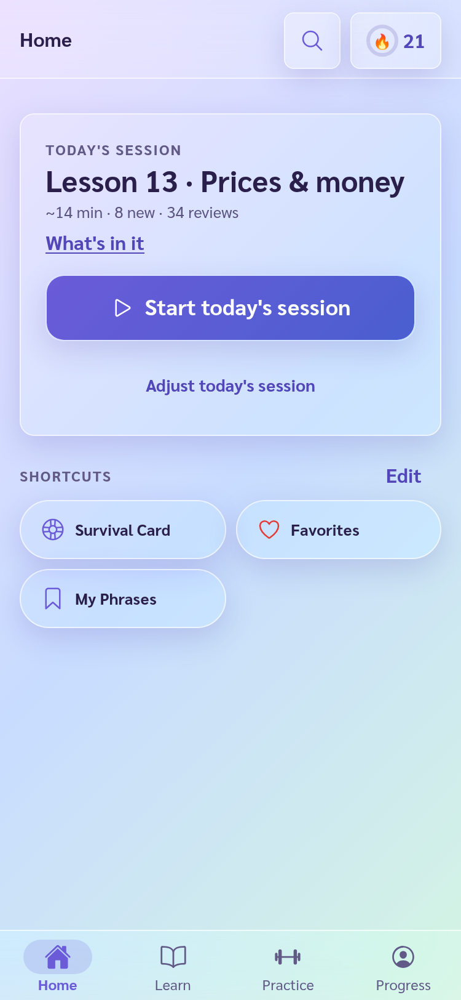
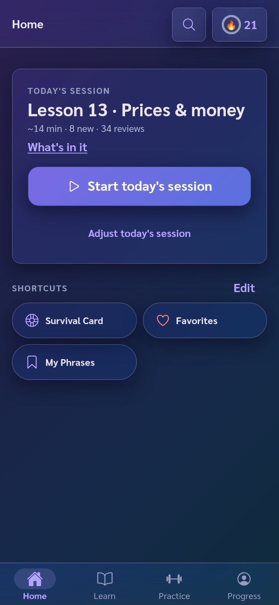

# Visual identity — "Sunrise / Blue hour"

The look of Learn Thai, extracted so it can be reused (or adapted) across
other apps, by people or by AI agents.

 

## What's here

| File | What it is | Use it when |
| --- | --- | --- |
| [`GUIDELINES.md`](GUIDELINES.md) | The design language: principles, color roles, the three surfaces, type, spacing, components, states, motion, a11y, how to adapt | You need to know *how* and *why* |
| [`AI_BRIEF.md`](AI_BRIEF.md) | A compact rules block to paste into another project's `CLAUDE.md` / agent instructions, plus prompt starters and non-web notes | You hand the work to Claude or another AI |
| [`tokens/tokens.css`](tokens/tokens.css) | All tokens as CSS variables, light + dark (`data-theme` or OS preference) | Any web app |
| [`components.css`](components.css) | Framework-free base styles: glass, buttons, chips, badges, segmented control, options, progress, chrome, focus, hit areas, scrollbars, motion | You want the components without a framework, or as a porting reference |
| [`tokens/theme.ts`](tokens/theme.ts) | The same values as a typed JS object (`getPalette('dark')`, `spacing`, `motion`, …) | JS-styled UIs, React Native, charts, canvas |
| [`tokens/tokens.json`](tokens/tokens.json) | W3C design-token JSON, generated from `theme.ts` | Figma (Tokens Studio), Style Dictionary → Swift/Kotlin/Dart |
| [`tokens/tailwind.preset.js`](tokens/tailwind.preset.js) | Tailwind preset mapped to the CSS variables (v4 note inside) | Tailwind projects |
| [`preview.html`](preview.html) | A live specimen page of every component, with a theme toggle | Checking the look, or showing an AI what "right" looks like |
| [`screenshots/`](screenshots/) | The original app, light and dark (Home, Practice, Progress) | Visual reference for people and multimodal models |

## Quick start (web)

```html
<link href="https://fonts.googleapis.com/css2?family=Sarabun:wght@400;600;700&display=swap" rel="stylesheet" />
<link rel="stylesheet" href="visual-identity/tokens/tokens.css" />
<link rel="stylesheet" href="visual-identity/components.css" />

<main class="page">
  <span class="eyebrow">Today</span>
  <h1 class="page-title">Hello</h1>
  <div class="glass">
    <button class="btn btn--primary btn--lg">Start</button>
    <button class="btn btn--tertiary">Not now</button>
  </div>
</main>
```

Dark mode follows the OS. To force a theme, set `<html data-theme="dark">` or
`"light"`.

To see the specimen, open `preview.html` from a local server (for example,
`npx serve "visual identity"`), because some browsers block stylesheets on `file://`.

## Keeping it in sync

The source of truth in this repo is still the app: `src/styles/theme.ts`,
`src/styles/global.css` and `src/styles/motion.ts`. If the app's theme
changes, update `tokens/theme.ts` and `tokens/tokens.css` to match, then
regenerate the JSON:

```bash
npx tsx "visual identity/tokens/build-json.ts"
```

Two values were reconciled on extraction. Both follow what the app actually
renders:

- **Dark primary gradient:** `global.css` draws `#7A6AE4 → #5A71DD`, while
  `theme.ts` says the CTA gradient is the same in both themes
  (`#6B5BD9 → #4A5FD0`). The identity uses the rendered value. White on it is
  4.2:1, so primary labels stay bold and at least 16px.
- **Token names:** the app's `reading` blue is `info` here. `warning-bg` and
  `accent-tint` are named versions of the app's inline `${color}24` and
  `${accent}1f` tints.
